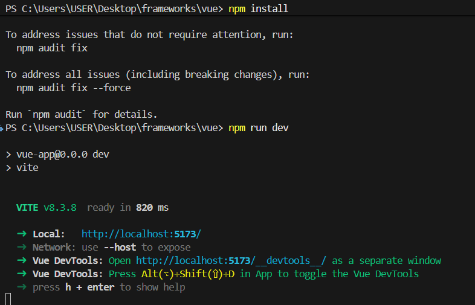

# Proyecto: Vue y Angular

Desarrollo de una misma aplicación web utilizando Vue.js y Angular, con el propósito de comparar ambos frameworks.

---

## 1. Instalación y ejecución

### Vue.js

**Instalación:**

```bash
cd vue-app
npm install
```

**Ejecución:**

```bash
npm run dev
```

### Angular

**Instalación:**

```bash
cd angular-app
npm install
```

**Ejecución:**

```bash
npm start
```

---

## 2. Evidencia de funcionamiento

### Vue.js




### Angular


