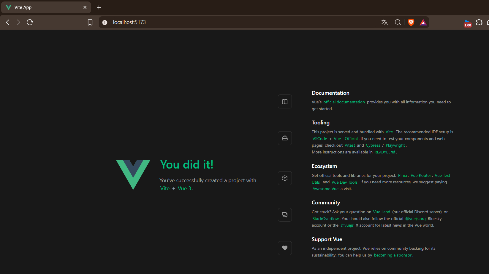
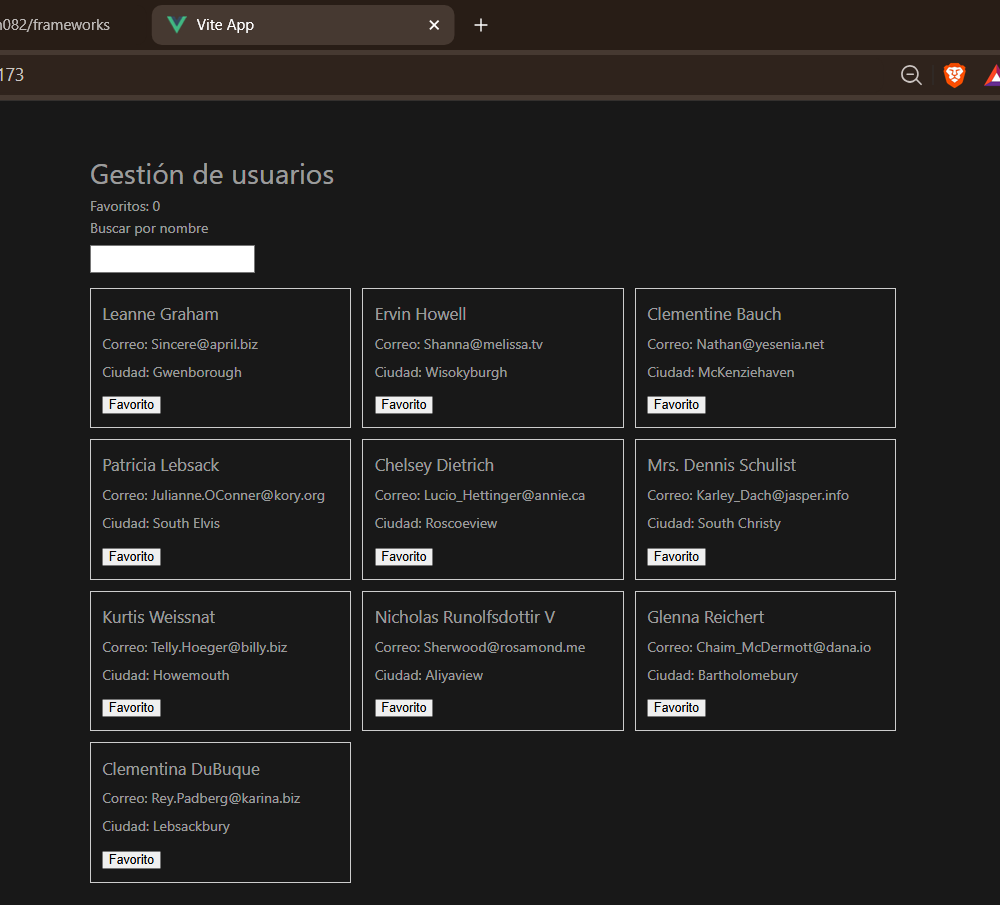
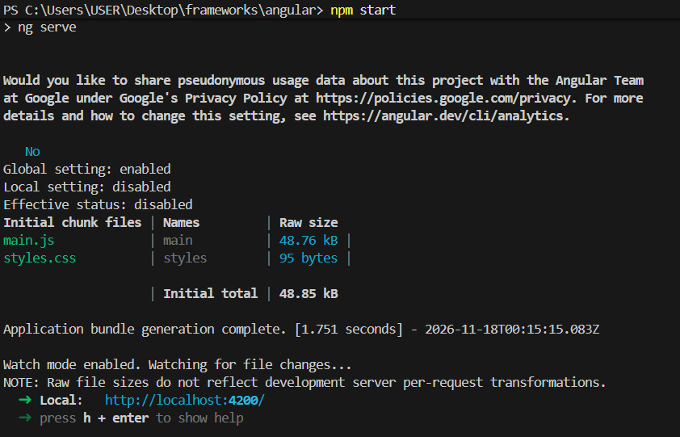
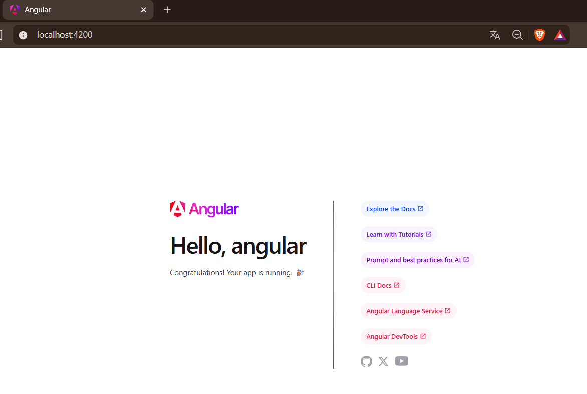
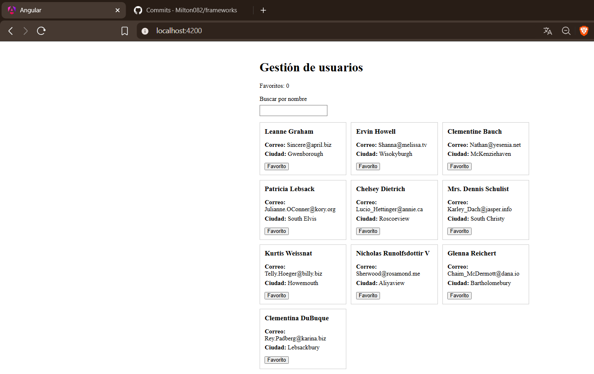
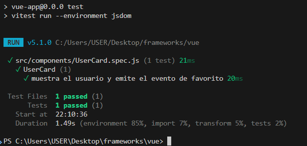
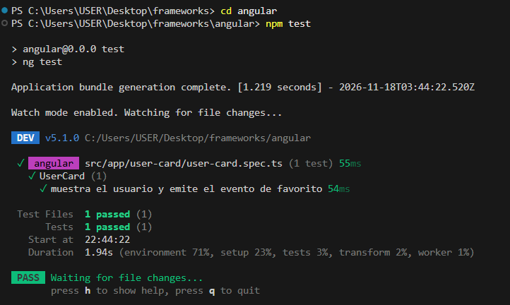

# Proyecto: Vue y Angular

**Por: Milton Chuqui**

Desarrollo de una misma aplicación web utilizando Vue.js y Angular, con el propósito de comparar ambos frameworks.

---

## 1. Instalación y ejecución

### Vue.js

**Instalación:**

```bash
cd vue-app
npm install
```

**Ejecución:**

```bash
npm run dev
```

### Angular

**Instalación:**

```bash
cd angular-app
npm install
```

**Ejecución:**

```bash
npm start
```

---

## 2. Evidencia de funcionamiento

### Funcionamiento inicial de Vue y Angular

### **2.1 Vue.js**






### **2.2 Angular**







## 3. Prueba unitaria

Las pruebas unitarias verifican que el componente de tarjeta de usuario muestre correctamente la información recibida y emita el evento de favorito al pulsar el botón. Se ejecutan de forma automática para comprobar que esta funcionalidad básica siga funcionando.

### **3.1 Vue.js**



### **3.2 Angular**


